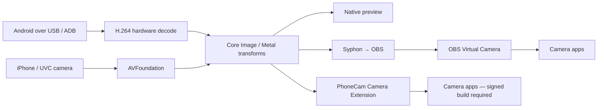

<p align="center">
  
</p>
<h1 align="center">PhoneCam</h1>
<p align="center"><strong>Your phone. Your Mac camera.</strong></p>
<p align="center">Turn a compatible Android phone or iPhone into a camera for your Mac.</p>
<p align="center">
  <a href="https://github.com/wybaby168/phonecam/actions/workflows/ci.yml"></a>
  <a href="LICENSE"></a>
  
</p>
<p align="center">English · <a href="README.zh-CN.md">简体中文</a></p>

Put the camera you already own to work. Give a Mac mini or a desktop setup a camera, improve a disappointing webcam feed with your phone’s camera, or position a spare phone above your desk for a demonstration. When your phone meets your needs, there is no need to buy another webcam.

PhoneCam is a local, open-source Mac utility with CLI controls and a native live preview. It targets mainstream Android and iPhone devices through three capture paths. Camera quality depends on the phone, lighting, framing and the receiving app; see the requirements below for compatibility.

> **Developer preview · macOS only.** Android USB → PhoneCam → OBS Virtual Camera → an independent browser has been visually verified. iPhone Continuity Camera and Android UVC capture are implemented but still need device validation. The bundled standalone PhoneCam camera extension requires signing and provisioning; it is **not activated by the local development build**. Homebrew distribution is pending.

## What you can do

| Use | What PhoneCam provides |
|---|---|
| Add a camera to a Mac without one | Use a compatible phone already on your desk |
| Improve a weak webcam setup | Use the phone’s existing camera and adjust its position and lighting |
| Video calls and online classes | Feed video into an app that accepts the selected system camera; check your app’s compatibility |
| Desk demos, documents and product close-ups | Position your phone freely, then rotate, mirror, crop or letterbox the video |
| OBS scenes and recordings | Share processed frames directly with OBS through Syphon; OBS handles recording or streaming |
| Repeatable setups and troubleshooting | Choose a device, size, frame rate and bitrate from the CLI; inspect structured diagnostics |

The app handles **video only**. It does not create a microphone, record footage, relay video through a cloud service, or install a login agent. Android capture does not require root or a separately installed companion APK.

## Phone compatibility

| Phone | Requirements | Capture path | Validation |
|---|---|---|---|
| Android 12+ | USB data cable, USB debugging, authorized ADB access; camera access must be supported by the device’s firmware | Pinned official scrcpy camera server → H.264 → VideoToolbox | **One physical Android device tested**, including an independent camera consumer |
| Android with a USB **Webcam** mode | The manufacturer must expose UVC; an Android version alone does not guarantee this feature | Native AVFoundation / UVC | Implemented; additional hardware testing needed |
| iPhone XR or later, including models introduced from 2018 | iOS 16+, macOS 13+, Apple Continuity Camera requirements | Native AVFoundation / Continuity Camera | Implemented; physical iPhone testing needed |
| Older phones without either supported path | No supported capture backend | — | Unsupported |

For iPhone, use the same Apple Account with two-factor authentication, enable Continuity Camera, keep Bluetooth and Wi-Fi on, and trust the Mac when connecting by USB. macOS manages the wired/wireless route; PhoneCam cannot independently attest to a USB-only iPhone connection. [Apple requirements](https://support.apple.com/en-us/102546)

Android camera capture requires Android 12 or later in the pinned server. Native USB webcam mode is a separate, manufacturer-dependent capability. [scrcpy camera support](https://github.com/Genymobile/scrcpy/blob/v3.3.4/doc/camera.md) · [Android UVC support](https://source.android.com/docs/core/camera/webcam)

An iPhone or UVC phone already exposed by macOS can also be selected directly in a camera app. PhoneCam adds CLI control, diagnostics and video transforms. [Contribute a device report](https://github.com/wybaby168/phonecam/issues/new?template=compatibility.yml) to expand the verified matrix.

## Start with the verified Android + OBS path

### 1. Build and install

You need macOS 13+, Xcode 15+ with its macOS SDK and Swift 5.9+, Python 3, and a USB data cable. Apple Silicon is the locally verified architecture. OBS must support Syphon input and have its virtual camera enabled by macOS; the recorded end-to-end test used OBS 32.2.2.

```bash
# Optional dependency installation with Homebrew
brew install --cask android-platform-tools obs

git clone https://github.com/wybaby168/phonecam.git
cd phonecam
./scripts/build.sh --unsigned
./scripts/install.sh
./scripts/setup-android.sh
```

The installer places the app in `/Applications/PhoneCam.app` and the launcher in Homebrew’s `bin` directory when available. It preserves the previous app and requests administrator access only when directory permissions require it. Run capture as your normal user.

`setup-android.sh` downloads official **scrcpy-server 3.3.4** and checks its pinned SHA-256. OBS, Syphon, ADB and the server binary are not included in this repository. [Dependency notices](THIRD-PARTY-NOTICES.md)

### 2. Connect and preview

Enable USB debugging on your Android phone, connect the cable and approve the Mac on the phone.

```bash
phonecam devices
phonecam preview --source android --require-hardware
```

A native window displays the processed phone video. Close it or press **Ctrl+C** to stop.

### 3. Make the video available to another app

```bash
phonecam preview --source android --require-hardware --syphon
```

In OBS:

1. Add a **Syphon Client** source and select **[PhoneCam] PhoneCam**.
2. Fit the source to the canvas.
3. Click **Start Virtual Camera**.
4. Select **OBS Virtual Camera** in your receiving app.

This path shares local GPU frames and does not require screen-recording permission. OBS supplies the system camera device. Stop the virtual camera in OBS when finished.

## iPhone and native USB webcam capture

Once macOS lists your phone as a camera:

```bash
# iPhone: meet Apple's Continuity Camera requirements first
phonecam preview --source continuity

# Android: select Webcam in the phone's USB settings first
phonecam preview --source uvc
```

Add `--syphon` to share processed video with OBS. These backends are available in source; their hardware verification status is shown above.

## Useful controls

```bash
# 1080p output when the source supports it
phonecam preview --source android --size 1920x1080 --fps 30 --bitrate 12M

# Rotate clockwise, mirror horizontally, and fill the output frame
phonecam preview --source android --rotate 90 --mirror --fit fill

# Select the front camera on Android
phonecam preview --source android --facing front

# Capture statistics without opening a preview window
phonecam probe --source android --duration 10 --require-hardware --json

# Inspect permissions, devices and extension status
phonecam doctor --json
phonecam help
```

Available bridge sizes: **640×480, 1280×720, 1920×1080**. Accepted frame rates: **15, 24, 25, 30, 60fps**, subject to the source device’s capabilities. The default is 720p30. Output resolution does not increase the source camera’s detail, and the receiving app may negotiate a different format.

`probe` reports captured/processed frame counts; a real preview is still needed to check image content, orientation and motion. `run` publishes to the project’s own **PhoneCam USB Camera** extension and requires the [signed build setup](docs/SIGNING.md). It is separate from the verified OBS path.

## How it works



A bounded latest-frame buffer limits backlog. Android uses a pinned USB ADB transport and hardware-capable H.264 decoding. The app processes frames locally using system graphics APIs. Normal shutdown cleans up its temporary server and ADB forwarding; reconnection targets the same established phone.

[Architecture](docs/ARCHITECTURE.md) · [Privacy and security](SECURITY.md) · [Validation evidence](docs/VERIFICATION.md)

## Platform and release status

- **macOS:** current product target. The local Apple Silicon build and Android + OBS path are verified. Intel is buildable from source but not validated on physical Intel hardware.
- **Windows:** unsupported for now. A Windows compiler target cannot replace AVFoundation, Metal, AppKit and CoreMediaIO. A working port needs Windows capture, decoding, rendering and virtual-camera backends. [Windows assessment](docs/PLATFORMS.md)
- **Linux:** portable core tests only; no camera app or virtual camera is shipped.
- **Distribution:** source-first developer preview. Standalone extension signing, notarization, broader device/app testing and Homebrew packaging remain release gates.

## Contribute

Device compatibility reports, reproducible bug reports and focused patches are welcome. See [CONTRIBUTING.md](CONTRIBUTING.md) for the build/test loop and what counts as hardware validation.

```bash
./scripts/test.sh
```

CI runs portable core tests on Linux and builds/tests the unsigned Mac app. CI does not certify phone hardware, camera permissions or a signed virtual camera installation.

[Roadmap](docs/ROADMAP.md) · [Changelog](CHANGELOG.md) · [Report a bug](https://github.com/wybaby168/phonecam/issues/new?template=bug.yml)

## License

[MIT](LICENSE). Third-party components keep their own licenses; see [THIRD-PARTY-NOTICES.md](THIRD-PARTY-NOTICES.md). PhoneCam is an independent project and is not affiliated with Apple, Google, Genymobile or OBS.
