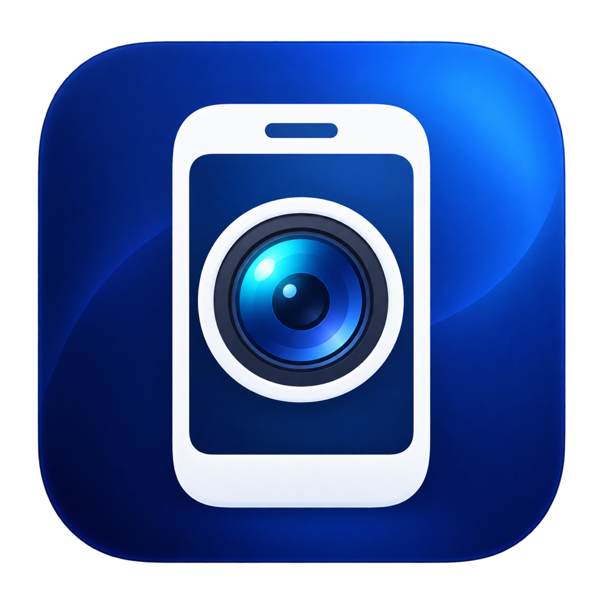

<p align="center"></p>
<h1 align="center">PhoneCam</h1>
<p align="center"><strong>让已有手机，成为 Mac 的摄像头。</strong></p>
<p align="center">通过 Android 或 iPhone，为 Mac 增加摄像头、改善视频画面。</p>
<p align="center"><a href="https://github.com/wybaby168/phonecam/actions/workflows/ci.yml"></a> <a href="LICENSE"></a> </p>
<p align="center"><a href="README.md">English</a> · 简体中文</p>

Mac 没有摄像头，或现有摄像头的画面不够理想时，可以先用手边的手机。PhoneCam 把手机摄像头接入 Mac，适合视频沟通、远程教学、桌面演示和 OBS 场景；手机能满足需求时，就不用再单独购买摄像头。

项目面向主流 Android 和 iPhone 设备，提供三种接入路径。实际兼容性取决于系统版本、厂商能力和接收应用；实际清晰度也受镜头、光线、摆放和视频压缩影响。

> **当前为开发预览版，仅支持 macOS。** 已真实测通 Android USB → PhoneCam → OBS Virtual Camera → 独立浏览器画面。iPhone 连续互通和 Android UVC 路径已实现，等待更多真机验证。PhoneCam 自带系统扩展需要正式签名与配置描述文件，本地开发包不能激活该扩展；Homebrew 尚未发布。

## 能做什么

| 场景 | 用法 |
|---|---|
| Mac mini、台式机没有摄像头 | 使用已有的兼容手机补齐视频输入 |
| 现有摄像头画面不理想 | 使用手机镜头，调整光线与位置，改善拍摄条件 |
| 视频沟通、远程教学 | 在支持所选系统摄像头的应用中接入视频，按应用版本验证兼容性 |
| 文档、产品、手工过程演示 | 灵活摆放手机，通过旋转、镜像、裁剪或留边调整画面 |
| OBS 录制与直播 | 通过 Syphon 传入处理后的视频，录制与直播由 OBS 完成 |
| 固定机位、排查问题 | CLI 选择设备、分辨率、帧率和码率，输出结构化诊断 |

PhoneCam 本身只处理视频，不创建麦克风、不录制、不经过云端、不设置开机启动。Android 路径不需要 root，也不需要另外安装常驻伴侣 APK。

## 手机支持范围

| 手机 | 要求 | 接入方式 | 当前验证状态 |
|---|---|---|---|
| Android 12+ | USB 数据线、USB 调试、授权 ADB；手机固件允许相机访问 | 固定版本 scrcpy camera server → H.264 硬件解码 | **已实测一台 Android 真机及独立接收端** |
| 带 USB「网络摄像头 / Webcam」模式的 Android | 厂商实现 UVC；不能仅凭 Android 版本判断 | AVFoundation / UVC | 已实现，待更多真机验证 |
| iPhone XR 及后续机型，包括 2018 年起发布的机型 | iOS 16+、macOS 13+，满足 Apple 连续互通相机条件 | AVFoundation / 连续互通 | 已实现，待 iPhone 真机验证 |
| 不满足以上任一路径的旧手机 | 暂无对应采集实现 | — | 暂不支持 |

iPhone 需与 Mac 使用同一 Apple 账户、开启双重认证、连续互通相机、蓝牙和 Wi-Fi；通过 USB 使用时还需信任 Mac。实际有线/无线路由由 macOS 管理，PhoneCam 不能独立证明 iPhone 只通过 USB 传输。[Apple 官方要求](https://support.apple.com/zh-cn/102546)

Android ADB 相机采集要求 Android 12+；原生 USB Webcam 是另一项由厂商提供的能力。[scrcpy 相机说明](https://github.com/Genymobile/scrcpy/blob/v3.3.4/doc/camera.md) · [Android UVC 说明](https://source.android.com/docs/core/camera/webcam)

已被 macOS 识别的 iPhone/UVC 手机也能直接在摄像头应用中选择。PhoneCam 进一步提供 CLI 控制、诊断与图像变换。欢迎[提交兼容性报告](https://github.com/wybaby168/phonecam/issues/new?template=compatibility.yml)，逐步扩充真实验证的机型列表。

## 从已验证的 Android + OBS 路径开始

### 1. 构建安装

需要 macOS 13+、Xcode 15+ 及其 macOS SDK / Swift 5.9+、Python 3 和 USB 数据线。本机验证使用 Apple 芯片 Mac。OBS 需支持 Syphon 输入，并由 macOS 正常批准虚拟摄像头；本次验收版本为 OBS 32.2.2。

```bash
# 可用 Homebrew 安装运行依赖
brew install --cask android-platform-tools obs

git clone https://github.com/wybaby168/phonecam.git
cd phonecam
./scripts/build.sh --unsigned
./scripts/install.sh
./scripts/setup-android.sh
```

安装位置为 `/Applications/PhoneCam.app`；已有 Homebrew 时，命令入口默认使用 Homebrew 的 `bin` 目录。安装器保留旧包，只在目录权限不足时请求管理员权限。日常运行使用普通用户。

`setup-android.sh` 下载官方固定版本 **scrcpy-server 3.3.4** 并校验 SHA-256。仓库不附带 OBS、Syphon、ADB 或 server 二进制。[依赖与许可](THIRD-PARTY-NOTICES.md)

### 2. 连接并预览

手机开启 USB 调试，连接数据线，在手机上授权本机。

```bash
phonecam devices
phonecam preview --source android --require-hardware
```

原生窗口会显示处理后的实时画面。关闭窗口或按 **Ctrl+C** 停止。

### 3. 输出给其他应用

```bash
phonecam preview --source android --require-hardware --syphon
```

在 OBS 中添加 **Syphon 客户端**，来源选择 **[PhoneCam] PhoneCam**，将画面「比例适配屏幕」，然后点击「启动虚拟摄像机」。接收应用选择 **OBS Virtual Camera**。

此路径通过本机 GPU 共享视频帧，不需要录屏权限；系统摄像头由 OBS 提供。用完后停止 OBS 虚拟摄像头。

## iPhone 与 Android 原生 Webcam

macOS 已能识别手机摄像头后：

```bash
# 先满足 Apple 连续互通相机要求
phonecam preview --source continuity

# 先在 Android 的 USB 设置中选择 Webcam
phonecam preview --source uvc
```

附加 `--syphon` 可把处理后的画面交给 OBS。这两条采集路径的真机验证状态见上表。

## 常用操作

```bash
# 手机支持对应模式时，输出 1080p / 30fps
phonecam preview --source android --size 1920x1080 --fps 30 --bitrate 12M

# 顺时针旋转、水平镜像、铺满画面
phonecam preview --source android --rotate 90 --mirror --fit fill

# Android 前置摄像头
phonecam preview --source android --facing front

# 仅采集统计，不打开预览窗口
phonecam probe --source android --duration 10 --require-hardware --json

# 综合诊断和完整参数
phonecam doctor --json
phonecam help
```

桥接尺寸支持 **640×480、1280×720、1920×1080**；帧率接受 **15、24、25、30、60fps**，默认 720p30，须由手机实际支持。接收应用可以协商不同输出格式；提高输出尺寸不等于增加源图像细节。

`probe` 的帧数不能替代画面验收，仍需检查真实内容、方向和动作。`run` 使用项目自己的 **PhoneCam USB Camera** 扩展，须按[签名说明](docs/SIGNING.md)配置，与已验证的 OBS 路径不同。

## 实现与平台

Android 经 USB ADB 传入 H.264，使用 VideoToolbox 解码；iPhone/UVC 使用 AVFoundation；Core Image / Metal 完成图像变换，输出到原生预览、Syphon 或签名后的 CoreMediaIO 扩展。最新帧缓冲限制积压，重连锁定同一台设备，正常退出清理本次 ADB 转发与临时 server。

- **macOS：** 当前产品平台，已验证 Apple 芯片和 Android + OBS 路径；Intel 可从源码构建，未在 Intel 真机验收。
- **Windows：** 暂不支持。需要替换采集、解码、渲染、窗口和虚拟摄像头实现，不能直接通过交叉编译得到可用程序。[平台评估](docs/PLATFORMS.md)
- **Linux：** 仅运行可移植核心测试，不提供摄像头应用。
- **发布：** 当前以源码开发预览版提供。独立扩展的签名、公证、更多机型和应用验证、Homebrew 分发仍待完成。

[架构](docs/ARCHITECTURE.md) · [隐私与安全](SECURITY.md) · [真实验收记录](docs/VERIFICATION.md)

## 参与维护

欢迎兼容性报告、可复现问题和范围明确的修复。[贡献指南](CONTRIBUTING.md)说明了构建、测试和真机证据要求。

```bash
./scripts/test.sh
```

CI 执行 Linux 核心测试和 macOS 开发包构建测试，不代表手机硬件、系统权限或正式签名扩展已通过验收。

[路线图](docs/ROADMAP.md) · [变更记录](CHANGELOG.md) · [反馈问题](https://github.com/wybaby168/phonecam/issues/new?template=bug.yml)

## 许可

项目使用 [MIT](LICENSE)，外部组件遵守各自许可，见 [THIRD-PARTY-NOTICES.md](THIRD-PARTY-NOTICES.md)。本项目与 Apple、Google、Genymobile、OBS 无隶属关系。
